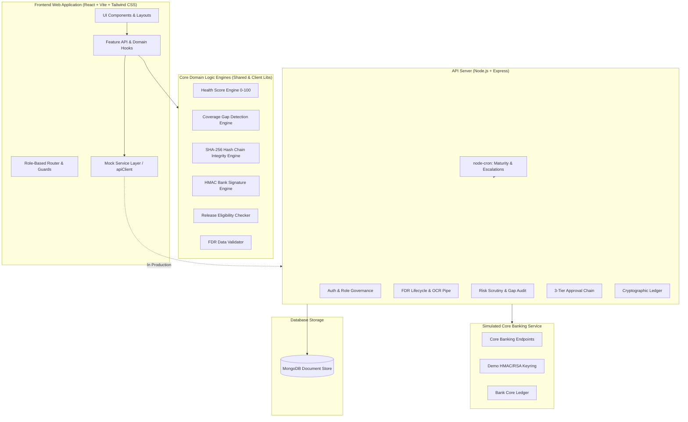

# FDR Trust Ledger — System Architecture

## Architecture Overview

FDR Trust Ledger is designed as a secure, role-based compliance tracking system for institutional Fixed Deposit Receipts pledged in favour of the AICTE.

## Core Architectural Guarantees

1. **Strict Separation of Concerns:**
   - **Pages** perform no direct HTTP requests; all operations flow through domain `api.js` modules.
   - **Controllers** maintain zero business logic; execution delegates to dedicated domain services.
   - **Single Source of Truth:** Constants (`ROLES`, `FDR_STATUS`, `TRUST_LEVELS`, `ROUTES`) are centralized in `@fdr/shared` to eliminate state discrepancy.

2. **Immutable Audit Ledger:**
   - Every state transition generates a block: `H_n = SHA-256(H_{n-1} | timestamp | userId | action | recordId | payload)`.
   - Any retrospective tampering instantly invalidates all downstream hashes, making unauthorized alterations cryptographically detectable.

3. **Multi-Way Scrutiny Reconciliation:**
   - Three independent streams of truth (Institution Claim, OCR Extracted Text, Bank Cryptographic Response) are audited concurrently to catch deposit inflation or forged certificates.
