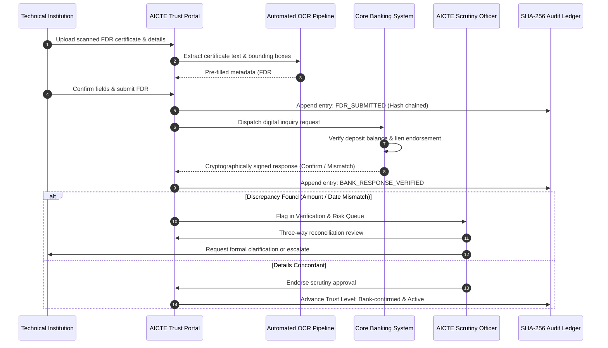

# Fixed Deposit Verification & Reconciliation Flow

This document outlines the four-step verification lifecycle of an FDR from initial submission to final regulatory custody.

## Scrutiny Reconciliation Rules

1. **Amount Parity:** The claimed amount must equal the bank's signed affirmation. Any shortfall is flagged with deduction in health score.
2. **Lien Clause:** Endorsement must explicitly designate "Member Secretary, AICTE, New Delhi".
3. **Maturity Coverage:** Valid until or past the statutory programme approval tenure.
